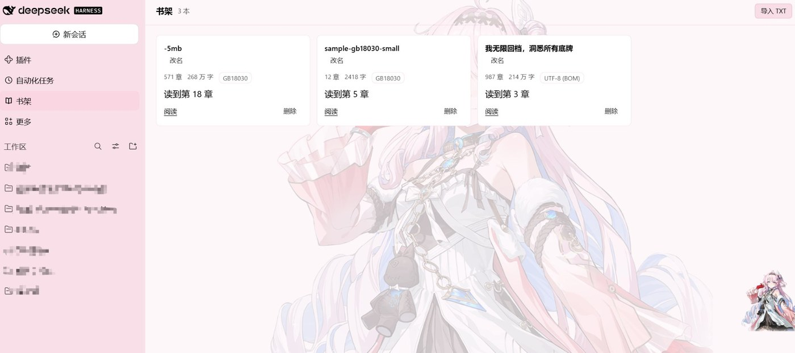
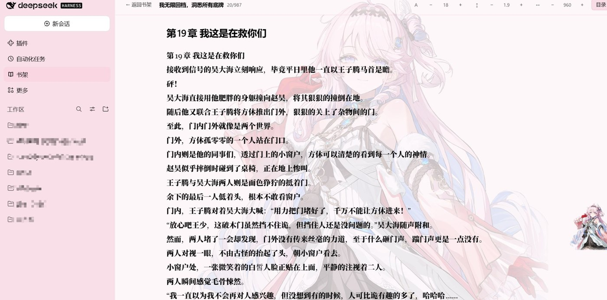

# dsh-novels

**English** | [简体中文](README.zh-CN.md)

Read `.txt` novels inside DeepSeek Harness: import a file, get chapters split
automatically, and read it in a panel next to the conversation.



Status: **Phase 2/3 complete** — upload, shelf, reader, progress restore, rename,
delete, reader prefs (font size, line height, page width), upload progress,
long-book table-of-contents grouping, empty/error/loading states.

Features:

- Import `.txt` by button or drag & drop; 20 MB cap, UTF-8/BOM/GB18030/GBK/Big5/UTF-16.
- Automatic chapter split with a 4000-character block fallback.
- Shelf cards show chapter/character counts, encoding, reading progress bar and
  "读到第 N 章"; rename in place; delete with confirmation.
- Reader: table of contents, previous/next chapter, font size, line height, page
  width, keyboard (← → PageUp PageDown Space j k Esc Ctrl±), chapter counter and
  a bottom progress line.
- Reading position (chapter + scroll offset) and reader prefs persist on the Host,
  so they survive a reload and a restart. `/api` ports change every launch, so the
  client keeps no state of its own.
- Long books (>300 chapters) get a grouped table of contents (100-chapter blocks,
  only the active block expanded).

## Screenshots

**Reader** — table of contents, font size / line height / page width controls,
chapter counter, keyboard navigation.



**Grouped table of contents** — books over 300 chapters are split into blocks of
100, with only the current block expanded.


## Panel styling

The stylesheet is installed **once into `document.head`** when the plugin
activates (`ensureStyles()`, tag `style[data-plugin-css="dsh-novels/panel.css"]`).

It used to be a `<style>` element rendered inside the shelf's own tree. Every
rule lives in the same string, so the shelf looked right — but opening a book
unmounted the shelf, the style element went with it, and the reader lost the
whole sheet: no `height:100%`, no flex column, no `overflow:auto`. The symptom
was a reader that could not scroll and a chapter footer pushed out of the panel.
Keeping the sheet in `head` makes it independent of whichever view is mounted.
`render.test.mjs` asserts both halves of that contract (sheet in `head`, no
`<style>` inside the panel tree).

## Install

```powershell
# clone once, then install from the DSH profile that should carry the plugin
git clone https://github.com/darlingsakurua/dsh-novels.git
plugin_manager install_bundle target="<path-to-your-clone>"
```

The bundle is linked (not copied), so edits under `client/` and `lib/` apply
after the plugin is reloaded (`plugin_manager set_plugin target="include:dsh-novels" enabled=false` then `true`).

## Layout

```
dsh-novels/
  package.json         dsh.bundle.patch + dsh.client (platform: web)
  cordis.patch.yml     inserts the bundle into the profile
  icon.svg             sidebar glyph (currentColor)
  locale/{zh,en}.json  panel title for the sidebar tooltip
  lib/index.mjs        Host half: HTTP routes under /dsh-novels/api/v1
  lib/store.mjs        Host half: library index, atomic writes, path checks
  client/index.mjs     Web half: shelf + reader, plus the text pipeline
```

Data lives in `<profileDir>/plugin-data/dsh-novels/`:

```
library.json            {version, prefs, books[]}
books/<id>.txt          normalized UTF-8 body
books/<id>.chapters.json  [{i, title, start}]
```

## API

All routes are gated exactly like the shipped `/api` channel (the request must
carry the browser session the shell already forwards).

| Method | Path | Purpose |
| --- | --- | --- |
| GET | `/ping` | diagnostics (`dataDir`, `bookCount`, version) |
| GET | `/library` | books + reader prefs |
| POST | `/books` | `{name, text, encoding, chapters}` → book |
| GET | `/books/{id}` | book + chapter offsets |
| GET | `/books/{id}/text` | full body as `text/plain` |
| PATCH | `/books/{id}` | rename (`{title, author}`) |
| PATCH | `/books/{id}/progress` | `{chapterIndex, offsetChars, percent}` |
| DELETE | `/books/{id}` | remove book and its files |
| PATCH | `/prefs` | `{fontSize, lineHeight, measure, fontFamily}` |

Envelopes are `{ok: true, ...}` or `{ok: false, error, message}`; request bodies
are capped at 24 MB for uploads and 64 KB for everything else. The client rejects
files over 20 MB before reading them; the Host cap leaves room for the JSON
envelope (body + chapter offsets).

## Text pipeline

`client/index.mjs` decodes bytes in this order: BOM (UTF-8/UTF-16) → strict
UTF-8 → GB18030 → GBK → Big5. Line endings are normalized to `\n` before
chapter offsets are computed, because every offset is a character index into
that normalized text.

Chapter headings are matched with `^第…[章节回卷篇部集]` and
`^Chapter/Part/Book N`. A heading with less than 200 characters before the next
one is treated as a false positive and dropped (the previous chapter absorbs
it); the final chapter is always kept. Files with no heading at all are split
into 4000-character blocks.

Tables of contents above 300 chapters are rendered in blocks of 100 (`1–100`,
`101–200`, …) with only the block holding the current chapter expanded. Grouping
by the first character of the title was tried first and abandoned: nearly every
Chinese chapter heading starts with 第, so it produced a single bucket.

## Tests

No test runner needed — plain Node scripts, each printing `ok`/`FAIL` lines:

```powershell
node _test/store.test.mjs        # Host store: index, atomic writes, clamping
node _test/client-parse.test.mjs # decode/normalize/split (bundled client code)
node _test/host-api.test.mjs     # routes, envelopes, 401/403 gate, limits
node _test/perf.test.mjs         # 5 MB GB18030 sample end to end
node _test/render.test.mjs       # shelf → upload → read → delete, headless React
```

`render.test.mjs` loads the real client bundle with a miniature React (hooks +
static tree) and points `fetch` at a server wired to the plugin's own Host
routes, so the browser flow is exercised without a browser. `_test/tmp/`
holds its throwaway profiles.

`_test/make-sample.mjs` regenerates the GB18030 samples in `samples/`
(the 5 MB one is handy for checking upload time by hand).

## Manual acceptance

These cannot be automated from here (the sandbox cannot start a browser):

1. Import `samples/sample-gb18030-small.txt` and `samples/sample-gb18030-5mb.txt`.
2. Read past chapter 10 of the 5 MB book, scroll mid-chapter, go back to the shelf
   — the card should read "读到第 N 章" with a filled bar.
3. Reopen it: same chapter, same scroll offset, same font size/line height/width.
4. Rename a book on the shelf; the reader header follows the new title.
5. Toggle the app theme (light/dark): all panel surfaces and text follow the
   `--dsw-alias-*` tokens.
6. Disable the plugin (`set_plugin target="include:dsh-novels" enabled=false`):
   the 书架 icon disappears and `/dsh-novels/api/v1/ping` returns 404; re-enable
   and refresh to get it back with the same books.


## Rules this plugin follows

- Never require `@deepseek-ai/dsh-client-*`; only `react` and the builtins.
- Never poke `document.body` or use an iframe; the panel is a React tree in a slot.
  (The stylesheet is a `<style>` in `head`, installed imperatively — like the
  shell's own style service does — not DOM inside the panel.)
- Styles use `--dsw-alias-*` tokens only — no literal colors.
- Keyboard shortcuts live on the reader container, never on `window`.
- The API prefix is `/dsh-novels/api/v1`; `/api` belongs to the connection channel.

## License

[MIT](LICENSE) © 2026 darlingsakurua
